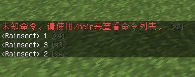

# Chat Compact

一个 **纯客户端** 的 Minecraft 1.12.2 Forge 模组：把聊天里重复出现的相同消息折叠成一行，并在末尾显示 `[xN]` 计数，专治服务器刷屏公告。

例如服务器反复发送的「本服禁止丢弃与掉落物品。」会被收成一行并滚计数：



## 功能特性

- **相同即合并**：只要消息文本一字不差，就会合并到同一行并累加计数 —— 不要求连续出现（中间夹了别的消息也会继续累加）。
- **原位更新**：合并后的那一行会移动到最新出现的位置，计数实时刷新，观感和刷屏公告一致。
- **不误伤玩家对话**：`<玩家A> 你好` 与 `<玩家B> 你好` 文本不同，视为不同消息，各自独立，不会被错误合并。
- **计数封顶**：超过 100 次显示 `[x100+]`，避免超长。
- **不碰 action bar**：头顶的伤害/提示条（`GAME_INFO`）不参与折叠。
- **内存可控**：用 LRU 最多同时跟踪 512 种不同文本，长时间挂机也不会无限增长。
- **零依赖、纯客户端**：不需要服务端安装，联机时对方没有本模组也能正常使用。

## 安装

1. 安装 Minecraft 1.12.2 + Forge（`14.23.5.x`）。
2. 下载 `ChatCompact-1.0.0.jar`（见 [Releases](../../releases)）。
3. 把 jar 放入 `.minecraft/versions/<版本>/mods/`（或对应启动器的 mods 目录）。
4. 启动游戏即可，无需任何配置。

## 兼容性

- Minecraft：`1.12` / `1.12.2`
- Forge：`14.23.5.x`（1.12.2 系列）
- 仅客户端生效，可安全用于多人服务器。

> 提示：模组依赖原版 `GuiNewChat` 的 chatId 去重机制。在标准 Forge 客户端上表现一致；如你在某些深度魔改聊天渲染的客户端上遇到不合并不生效的情况，欢迎开 Issue 反馈。

## 从源码构建

需要 **JDK 8**（ForgeGradle 3 编译反编译后的 Minecraft 需要 `tools.jar`）。

```bash
./gradlew build
```

产物在 `build/libs/ChatCompact-1.0.0.jar`（已自动 reobfuscate，可直接放进 mods）。

中国大陆网络建议：

- `build.gradle` 已配置 BMCLAPI maven 镜像兜底失效的 Mojang 依赖。
- 如 Gradle 发行版下载慢，可把 `gradle/wrapper/gradle-wrapper.properties` 的 `distributionUrl` 换成国内镜像（如 `https://mirrors.cloud.tencent.com/gradle/gradle-4.9-bin.zip`）。
- 若默认 JDK 非 8，可在 `gradle.properties` 里设置 `org.gradle.java.home` 指向你的 JDK 8 目录。

## 许可

[MIT](LICENSE) © 2026 Rainsect
